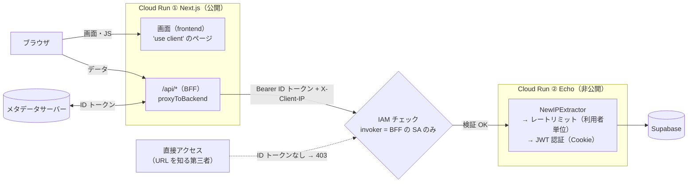
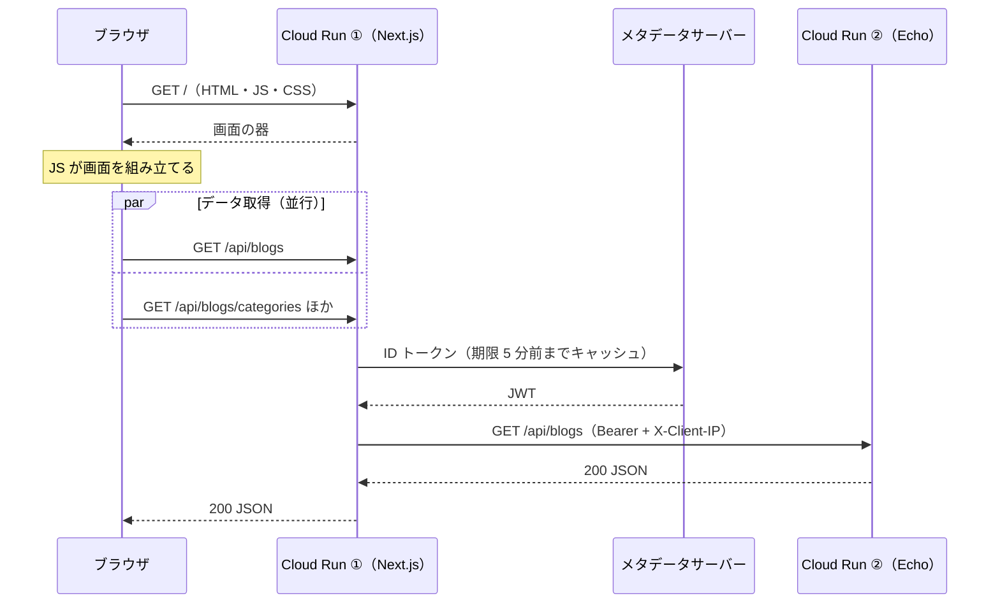

# BFF とバックエンドのサービス間認証 理解向上レポート

本レポートは、バックエンドを **BFF（フロントエンドの Next.js）だけが呼べる非公開の Cloud Run** にし、**レートリミットを利用者単位で効かせる**構成（#146 / #165）について、リクエストの経路と、どこで誰が検証されるかを理解するためのドキュメントである。

同じ内容の HTML 版: [05-bff-service-auth.html](./05-bff-service-auth.html)（見た目を整えた版。内容を変えるときは両方を更新する）

> 公開リポジトリのため、GCP のプロジェクト ID は `<backend-project>`（バックエンド）・`<front-project>`（フロント）と表記する。

---

## 目次

- [1. 全体像](#1-全体像)
- [2. 何が変わったか](#2-何が変わったか)
- [3. 認証は 2 段](#3-認証は-2-段)
- [4. クライアント IP を信頼できる理由](#4-クライアント-ip-を信頼できる理由)
- [5. ページを開いたときのリクエスト](#5-ページを開いたときのリクエスト)
- [6. 環境ごとの動き](#6-環境ごとの動き)
- [7. 切り替えの記録](#7-切り替えの記録)
- [8. 運用メモ](#8-運用メモ)
- [9. 関連](#9-関連)

---

## 1. 全体像

Cloud Run は **2 つ**である。画面と BFF（`/api/*`）は同じ Next.js アプリで、Cloud Run どうしの通信は「① → ②」の 1 本だけ。この区間を ID トークンで保護している。



- ① と ② は**別の GCP プロジェクト**にある。
- ② の手前で Google のフロントエンドが ID トークンを検証する。アプリのコードはサービス間の認証に関わらない。
- ID トークンのないリクエストは 403（不正なトークンは 401）で拒否され、**コンテナに届かない**（アクセスログにも出ない）。

## 2. 何が変わったか

| 項目 | 変更前 | 変更後 |
|---|---|---|
| バックエンドを呼べる相手 | 誰でも（URL を知っていれば） | BFF のサービスアカウントだけ（Cloud Run IAM） |
| 直接アクセス | アプリに届く | 403。Google のフロントエンドで止まる |
| BFF 経由の利用者の数え方 | 全員まとめて 1 枠（BFF の IP） | 利用者ごと（`X-Client-IP`） |
| ログインの総当たり | 攻撃者が連打すると、オーナーも最長 1 分ログインできない | 攻撃者の IP だけが 429 になる |
| アクセスログの `remote_ip` | BFF の IP | 利用者の IP |

## 3. 認証は 2 段

役割の違う 2 つの認証が、別のレイヤで動く。`Authorization` ヘッダはサービス間、Cookie は利用者に使うので、同じリクエストに両方が乗っても衝突しない。

| | サービス間の認証 | 利用者の認証 |
|---|---|---|
| 問い | 呼んでいるのは BFF か？ | ログインしているのはオーナーか？ |
| 仕組み | Cloud Run IAM ＋ ID トークン | アプリの JWT（HS256、`aud` で種類を区別） |
| 検証する場所 | Google のフロントエンド（アプリの外） | バックエンド（Echo） |
| 運ぶヘッダ | `Authorization: Bearer …` | `Cookie: token=…` |
| 失敗したとき | トークンなし 403、不正なトークン 401 | 401（統一エラーレスポンス） |

JWT と Cookie の詳細は [02-jwt-http-only-cookie.md](./02-jwt-http-only-cookie.md) を参照。

## 4. クライアント IP を信頼できる理由

`X-Client-IP` は誰でも書けるただのヘッダである。それでも信頼できるのは、次の 4 つが**順につながっている**からで、どれか 1 つが崩れると成り立たない。

1. **ブラウザ**: 偽装できるのは `X-Forwarded-For` の左側だけ。右端は Google のフロントエンドが接続元の IP を追加する（フロントはドメインマッピングで公開しており、ロードバランサは挟んでいない）。
2. **BFF**: 右端だけを使って `X-Client-IP` を作る（`_lib/clientIp.ts`）。IP として解釈できない値なら付けない。
3. **Cloud Run IAM**: バックエンドには BFF しか到達できない。だから `X-Client-IP` を書けるのは BFF だけになる。
4. **バックエンド**: `TRUST_CLIENT_IP_HEADER=true` のときだけヘッダを信頼する（`middlewares.NewIPExtractor`）。値が不正なら BFF の IP として数える（値を変えても回避できない）。

> **切り替え当日、3 が崩れていた。** サービスの invoker IAM チェックが無効（`run.googleapis.com/invoker-iam-disabled: true`）のままで、`allUsers` を外しても誰でも呼べた（#165）。そのため「非公開化」と「ヘッダの信頼」は、`deploy.yml` の同じ `gcloud run deploy` で必ずまとめて設定する。

なお、バックエンドが受ける `X-Forwarded-For` の右端は BFF の IP になる（② の手前の Google フロントエンドが、呼び出し元である BFF の IP を追加するため）。BFF が XFF にクライアント IP を書き足しても右端は BFF のままなので、別のヘッダ（`X-Client-IP`）が必要になる。

## 5. ページを開いたときのリクエスト

フロントのページはすべてクライアントコンポーネントである。まず画面の器（HTML・JS）を取り、そのあとブラウザがデータを `/api/*` から取る。`/api/*` の 1 リクエストにつき、① から ② へのリクエストが 1 本出る（トップページでは 5 本前後）。



- ID トークンは JWT の `exp` を読み、期限の 5 分前に取り直す。同時に来たリクエストは 1 回の取得にまとめる（`_lib/idToken.ts`）。
- 取得に失敗した場合はバックエンドを呼ばず、BFF が 500 `{"error":"Backend authentication failed"}` を返す。トークンなしで送ると Cloud Run が HTML のエラーを返し、フロントが未ログインと区別できないため。
- レートリミットの全体上限（毎秒 20 件・瞬間 60 件）は利用者ごとなので、通常の閲覧（1 ページ 5 本前後）で引っかかることはない。

## 6. 環境ごとの動き

| 環境 | ID トークン | `X-Client-IP` の信頼 | バックエンド |
|---|---|---|---|
| 本番（Cloud Run） | 付ける（`K_SERVICE` がある） | する | 非公開 |
| ローカル開発 | 付けない | しない（XFF から取る） | 公開（localhost） |
| IT / E2E | 付けない | しない | testcontainers |

ローカルとテストは従来どおり動くので、開発中に GCP の認証を意識する必要はない。

## 7. 切り替えの記録

2026-10-13（JST）。

| 時刻 | 内容 |
|---|---|
| 22:02 | フロント #150 をマージ。22:07 にデプロイ完了。BFF が ID トークンと `X-Client-IP` を付け始める（バックエンドはまだ公開なので影響なし）。BFF のサービスアカウントへの invoker 付与もこの前後に実施 |
| 22:09 | バックエンド #164 をマージ。デプロイ後の確認で、`allUsers` が外れているのに直接アクセスが 200 のままだと判明 |
| 22:10〜16 | **公開状態のまま `X-Client-IP` を信頼していた約 6 分間**。直接アクセスでヘッダを偽装すれば、レートリミットを回避できた。原因はサービスの `invoker-iam-disabled: true`（#165） |
| 22:16 | `--invoker-iam-check` を手動で適用。直接アクセス 403、BFF 経由 200、アクセスログの `remote_ip` が利用者の IP になったことを確認 |
| 22:22 | #166 をマージし、`deploy.yml` に `--invoker-iam-check` を追加。デプロイ後も状態が保たれていることを確認 |

**教訓**: 「設定が入ったか」ではなく「期待した効果が出たか」で検証する。IAM のバインディングだけを見ると問題なさそうだったが、直接 curl して初めて 200 だと分かった。

## 8. 運用メモ

- コンソールでバックエンドを「公開」に戻さない。invoker の IAM チェックが無効になり、IAM のバインディングに関係なく誰でも呼べるようになる。
- `--no-allow-unauthenticated`・`--invoker-iam-check`・`TRUST_CLIENT_IP_HEADER=true` は 1 つのデプロイで揃えて変える。片方だけ変えると、偽装でレートリミットを回避できる状態になる。
- レートリミットのカウントはインスタンスのメモリにある。最大 3 インスタンスなので、実効上限は最大 3 倍まで緩む。
- BFF の ID トークンが取れないと、BFF は 500 を返し、フロントのログに `Failed to obtain ID token for backend` が出る。

**BFF 経由が 401 / 403 になったときの切り戻し**（IAM チェックを無効にして一時的に公開へ戻す。数秒で効く）:

```bash
gcloud run services update echo-blog-app \
  --project <backend-project> --region asia-northeast1 \
  --no-invoker-iam-check
```

`TRUST_CLIENT_IP_HEADER=true` が残るので、公開のまま放置せず、原因を直して `--invoker-iam-check` に戻す。

**状態の確認**（`invoker-iam-disabled` が出力されなければ IAM チェックは有効）:

```bash
gcloud run services describe echo-blog-app \
  --project <backend-project> --region asia-northeast1 \
  --format='value(metadata.annotations)' | tr ';' '\n' | grep invoker
```

## 9. 関連

| 種類 | 参照先 |
|---|---|
| issue | #146 BFF 経由のレートリミットを利用者単位に / #165 invoker の IAM チェックが無効 |
| PR（バックエンド） | #164 非公開化と `X-Client-IP` の信頼 / #166 デプロイ時に IAM チェックを有効にする |
| PR（フロント） | nextjs-echo-blog-front-app-renew#150 ID トークンとクライアント IP の付与 |
| 仕様書 | [06-security-specification.md](../06-security-specification.md) 6.3（IAM）・8.2（レートリミット）/ [07-api-specification.md](../07-api-specification.md)「呼び出し元の制限」/ [09-architecture-specification.md](../09-architecture-specification.md) |
| フロントの仕様書 | nextjs-echo-blog-front-app-renew の `docs/09-architecture-specification.md`「バックエンドの呼び出し」 |
